## linear-time networks

Linear networks are basically networks that aim to achieve linear time complexity, and of course there have been many different architectures that try to pull this off.

To understand why anyone bothers chasing linear complexity when transformers already work so well, u just have to look at what happens when a prompt gets really long.

Standard self attention compares every token against every previous token, which means compute scales quadratically and the KV cache grows exponentially with sequence length.

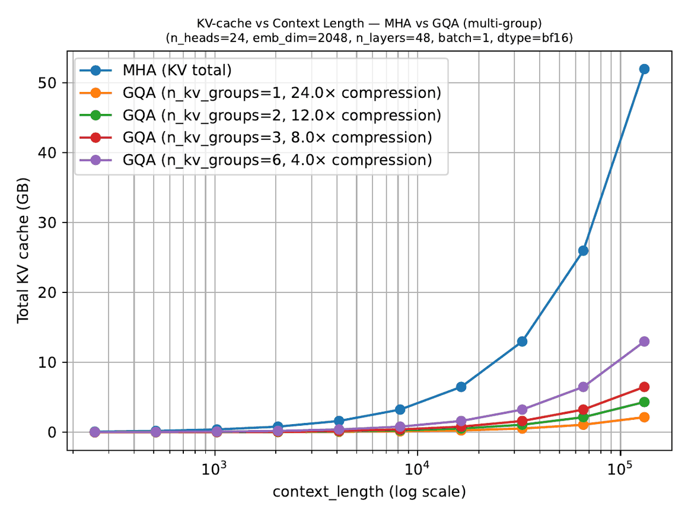

Once you push into hundreds of thousands or millions of tokens for coding agents and long documents, hauling that massive KV cache out of GPU memory for every single generated token turns into a brutal bandwidth bottleneck.

Linear networks solve this by making a very simple trade: instead of keeping a transcript of every token ever seen, they compress the entire history into a fixed size recurrent state.

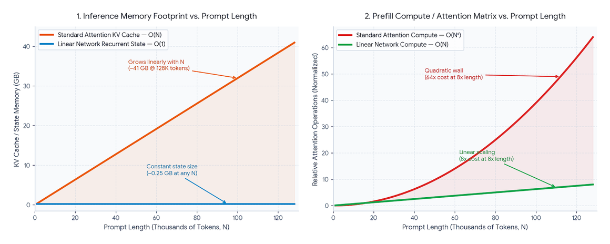

Updating that state costs constant memory and constant compute per token during generation, giving you linear complexity across the whole sequence. 

Most modern LLMs nowadays now combine this with attention in a 3:1 (linear attn / quad attn) ratio

Of course there are full linear time networks but researchers probably realised that having a hybrid formula is the best method (as of now)

I will cover these types of different types of linear models, linked below here so you can click to whichever arch you feel most comfotable ++ their simple torch implementations

(btw i am well aware of GRU but i will not include it because it is just a slightly different variant of RNN)

1. [RNN](#rnn) (Elman, 1990)
2. [LSTM](#lstm) (Hochreiter and Schmidhuber, 1997)
3. [SSM](#ssm) (S4, Gu et al., Oct 2021)
4. [RWKV](#rwkv) (Peng et al., May 2023)
5. [Mamba (1, 2, 3)](#mamba-s6) (Mamba 1, Gu and Dao, Dec 2023; Mamba 2, May 2024; Mamba 3, Mar 2026)
6. [GLA](#gla) (Yang et al., Dec 2023)
7. [GDN (1 and 2)](#gdn) (GDN 1, Yang et al., Dec 2024; Gated DeltaNet 2, May 2026)

## RNN

Before Transformers took over everything, the classic Recurrent Neural Network popularized by Jeffrey Elman in his 1990 paper [Finding Structure in Time](https://papers.baulab.info/papers/Elman-1990.pdf) was the original blueprint for linear time sequence modeling. At the time he called it Simple Recurrent Networks (SRN)

Instead of staring at the entire history of tokens at once, an SRN reads one token at a time and maintains a single hidden state vector that acts like a rolling summary of everything it has seen so far. (That explains the unfolding portion because it is repeating itself)

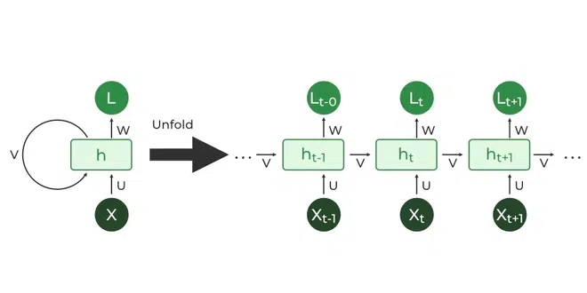

At every timestep, it simply takes the current input token, combines it with the previous hidden state through two learned weight matrices, and squashes the sum through a nonlinearity like tanh to produce the updated state. 

the image below is the original representation based on the research paper, but it a little hard to understand what is going on without the extra contexts so:

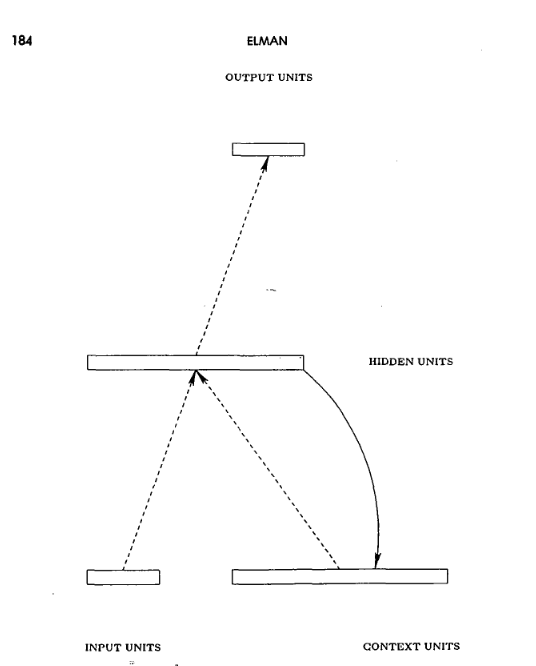

Here is the pytorch implementation

```python
import torch
import torch.nn as nn

class RNN(nn.Module):
    def __init__(self, d_in: int, d_hidden: int):
        super().__init__()
        self.d_hidden = d_hidden
        self.w_ih = nn.Linear(d_in, d_hidden)
        self.w_hh = nn.Linear(d_hidden, d_hidden, bias=False)

    def forward(self, x: torch.Tensor) -> torch.Tensor:
        # x: (batch, seq_len, d_in)
        B, T, _ = x.shape
        h = torch.zeros(B, self.d_hidden, device=x.device, dtype=x.dtype)
        outputs = []
        for t in range(T):
            h = torch.tanh(self.w_ih(x[:, t]) + self.w_hh(h))
            outputs.append(h)
        return torch.stack(outputs, dim=1)
```
The problem faced in RNN is that while cramming an entire sequence into a single fixed capacity hidden state gives you constant memory at inference, it creates severe mathematical and hardware bottlenecks during training. 

Because backpropagation through time repeatedly multiplies gradients across every step, small weights cause gradients to vanish and give the network amnesia over long dependencies, while large weights cause gradients to explode into unstable NaNs. 

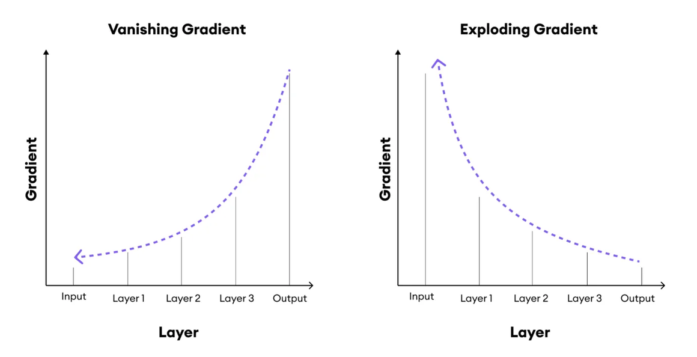

On top of that, standard RNNs only read left to right without future context, and because every step depends sequentially on the previous hidden state, GPUs cannot parallelize across time and are forced to crawl through long sequences one token at a time.
## LSTM

After RNNs, we then evolved towards [LSTMs](https://deeplearning.cs.cmu.edu/S23/document/readings/LSTM.pdf), short for long short term memory, introduced by Sepp Hochreiter and Jurgen Schmidhuber in 1997 to stop vanilla RNNs from developing amnesia after thirty tokens. 


The core problem with a standard RNN is that every single step multiplies the hidden state by the same weight matrix and squashes it through tanh, so early memories either decay exponentially into zero or blow up during backpropagation. 


LSTMs fix this by adding a separate memory highway running straight across the top of the cell from $C_{t-1}$ to $C_t$, protected by three learned gates that look at the incoming token $X_t$ alongside the previous hidden state $H_{t-1}$ to regulate what stays and what goes.

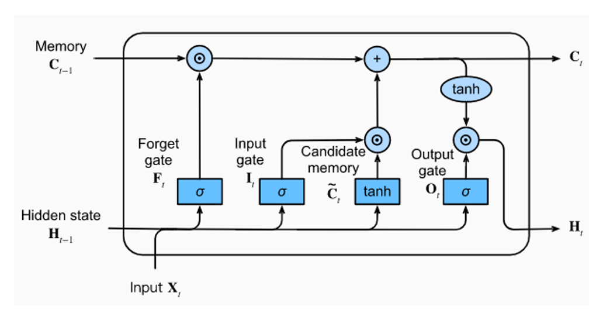

Walking across the diagram from left to right, the forget gate $F_t$ passes the combined inputs through a sigmoid layer and multiplies elementwise with the old cell memory $C_{t-1}$ to decide what information gets wiped out. 

Next, the input gate $I_t$ (another sigmoid valve) teams up with a tanh layer creating candidate memory $\tilde{C}_t$, multiplying them together before adding the result straight onto that top memory rail to form the updated cell state $C_t$. 

Finally, the output gate $O_t$ filters a tanh squashed version of the new cell state to produce the next hidden state $H_t$ passed onward to the rest of the network. 

Because updates along that upper $C_t$ rail are additive rather than purely multiplicative, gradients can flow backward across hundreds of timesteps without vanishing. 

Below is a general torch implementation on LSTMs

```python
import torch
import torch.nn as nn

class LSTM(nn.Module):
    def __init__(self, d_in: int, d_hidden: int):
        super().__init__()
        self.d_hidden = d_hidden
        self.w_ih = nn.Linear(d_in, 4 * d_hidden)
        self.w_hh = nn.Linear(d_hidden, 4 * d_hidden, bias=False)

    def forward(self, x: torch.Tensor) -> torch.Tensor:
        # x: (batch, seq_len, d_in)
        B, T, _ = x.shape
        h = torch.zeros(B, self.d_hidden, device=x.device, dtype=x.dtype)
        c = torch.zeros(B, self.d_hidden, device=x.device, dtype=x.dtype)
        outputs = []
        for t in range(T):
            gates = self.w_ih(x[:, t]) + self.w_hh(h)
            i, f, g, o = gates.chunk(4, dim=-1)
            i = torch.sigmoid(i)
            f = torch.sigmoid(f)
            g = torch.tanh(g)
            o = torch.sigmoid(o)
            c = f * c + i * g
            h = o * torch.tanh(c)
            outputs.append(h)
        return torch.stack(outputs, dim=1)

```

Still, you can already spot the problem: all those sigmoid and tanh blocks sit right inside the recurrent loop, meaning LSTMs still force GPUs to march through sequences one token at a time during training.


## SSM 

For awhile, we mainly relied on LSTMs as linear time networks. Of course, many variants came out. 

This was the case until Albert Gu, Karan Goel, and Christopher Re introduced [Structured State Spaces (S4)](https://arxiv.org/pdf/2111.00396) in late 2021, borrowing a classic control theory equation from the 1960s and using a simple trade: rip the nonlinearities out of the recurrent loop completely.

Without a tanh or sigmoid blocking every step, the hidden state update becomes a purely linear recurrence governed by fixed transition matrices initialized using a mathematical framework called [HiPPO](https://arxiv.org/pdf/2008.07669) so the state naturally compresses long histories without decaying into noise. 

At its core, SSM is governed by 2 equations

$$h'(t) = A h(t) + B x(t)$$
$$y(t) = C h(t) + D x(t)$$

The first equation updates the hidden memory state $h(t)$ by mixing the existing memory through matrix $A$ with the incoming signal $x(t)$ weighted by $B$, while the second equation reads out the relevant pieces through $C$ alongside a direct skip connection $D x(t)$. 

Because text arrives as discrete tokens rather than a smooth continuous wave, S4 discretizes $(A, B)$ using a step size $\Delta$ into discrete step matrices $(\overline{A}, \overline{B})$, turning the system into a clean recurrence $h_t = \overline{A} h_{t-1} + \overline{B} x_t$.

This can be visualized from this image (cudos to maarten grootendorst / gemini for this):

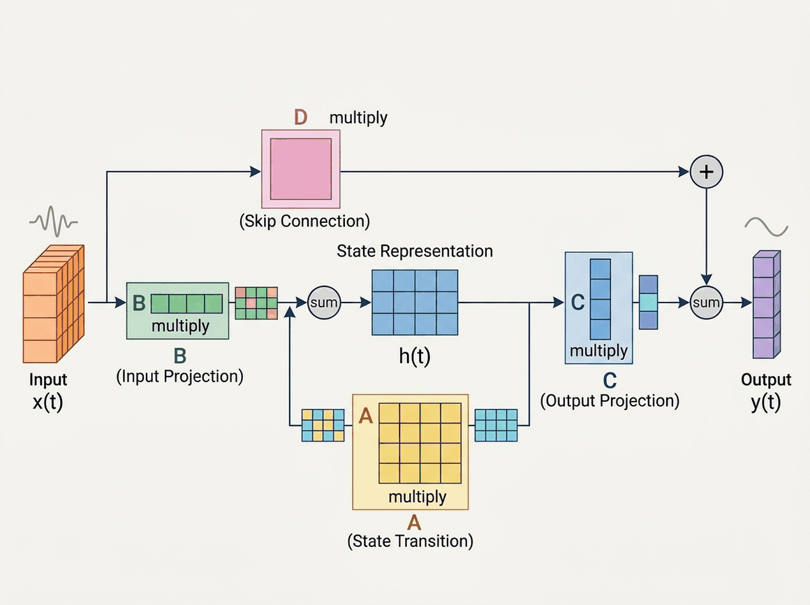

Walking across the diagram from left to right, the incoming signal $x(t)$ splits onto two tracks. On the main lower track, $x(t)$ gets multiplied by the green input matrix $B$ to encode the new token, and is immediately summed with the previous memory coming out of the yellow feedback loop $A$, updating that central cyan grid labeled State Representation. 

That feedback loop is the beating heart of the state space model: at every stepd, matrix $A$ takes the existing cyan state representation, transforms how old memories decay or mix together, and feeds it right back into the summation node. To produce the actual prediction, the updated state is projected through the blue output matrix $C$, while the upper track multiplies the raw input $x(t)$ directly by the pink matrix $D$ as a resiual skip connection, summing both paths together to emit the final output

That linearity unlocks a handy dual personality: at inference time, you step forward one token at a time using constant memory, whereas during training, you  unroll the recurrence into a single global convolution across the entire sequence in parallel. The catch is that computing that convolution filter naively for a dense HiPPO matrix $A$ would still blow up your GPU compute and memory.


Below is the KEY algorithm that I will focus on which enables S4 to run near-linear complexity during TRAINING mode:

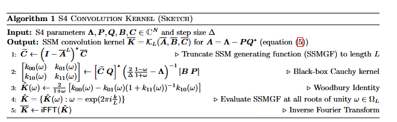

Though it looks complicated, I will try my best to break it down as simple as possible for you (with reference to the top image of course).

S4 splits its memory matrix into two easy parts: a simple grid of independent channels ($\Lambda$) plus a tiny shared correction ($PQ^*$). From there, it builds the filter in five steps:

1. **(Line 1):** First, we tell the math how long our sentence is ($L$) so the memory filter stops after $L$ tokens instead of stretching on forever.

2. **(Line 2):** Instead of doing heavy matrix math one step at a time, we flip into frequency space and solve the simple independent channels ($\Lambda$) all at once using a fast shortcut called a Cauchy kernel.
   
3. **(Line 3):** Those independent channels cannot talk to each other on their own, so we use a neat algebra shortcut (the Woodbury Identity) to patch the shared correction ($PQ^*$) back in without slowing anything down.
   
4. **(Line 4):** We evaluate that smooth frequency formula at $L$ evenly spaced points around a circle so it lines up cleanly with the $L$ tokens in our sentence.
   
5. **(Line 5):** Finally, we run an inverse Fast Fourier Transform (iFFT) to flip those frequency points back into a standard filter ($\overline{K}$) that slides across your whole prompt in parallel[cite: 8].

Once u have that filter $\overline{K}$, training runs across all tokens simultaneously on the GPU, while during chat inference you just throw the filter away and step forward one token at a time using constant memory.

I have also provided an image generated by Gemini to better visualize the core algo of S4
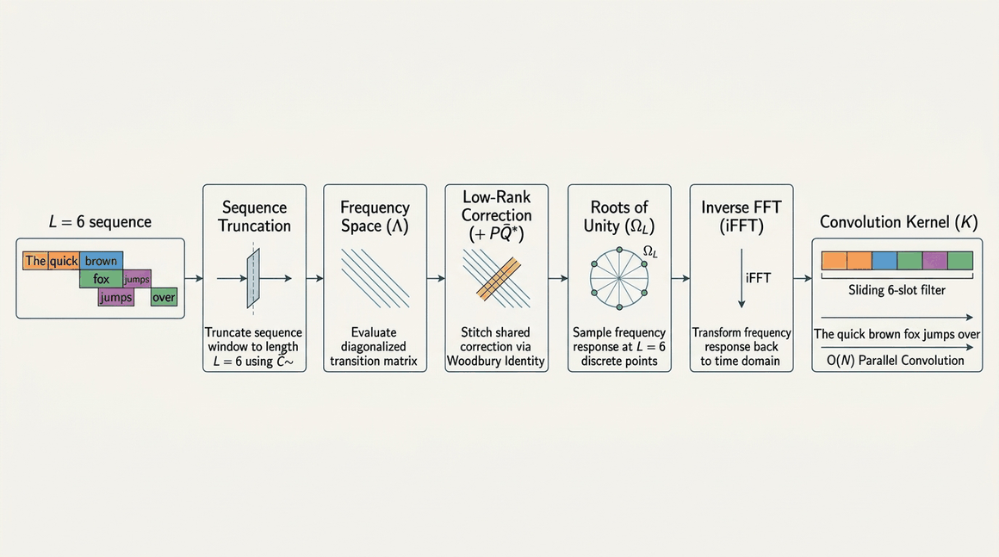

Below is a simple torch implementation

```python
import torch
import torch.nn as nn

class SSM(nn.Module):
    def __init__(self, d_model: int, d_state: int = 16):
        super().__init__()
        self.d_model = d_model
        self.d_state = d_state
        # Diagonal log-space state transition A (kept negative for stability)
        self.log_A = nn.Parameter(torch.randn(d_model, d_state))
        self.B = nn.Parameter(torch.randn(d_model, d_state) * 0.02)
        self.C = nn.Parameter(torch.randn(d_model, d_state) * 0.02)
        self.D = nn.Parameter(torch.ones(d_model))

    def _get_discrete_params(self):
        # Discretized diagonal state decay in (0, 1)
        A_bar = torch.exp(-torch.exp(self.log_A))  # (D, N)
        return A_bar, self.B, self.C

    def forward_parallel(self, x: torch.Tensor) -> torch.Tensor:
        # Parallel FFT convolution mode for training
        # x: (batch, seq_len, d_model)
        B_sz, T, D = x.shape
        A_bar, B_mat, C_mat = self._get_discrete_params()

        # Build global convolution kernel K of length T: K[t] = sum_n C * (A^t) * B
        powers = torch.arange(T, device=x.device).view(1, 1, T)
        kernel = (C_mat * B_mat).unsqueeze(-1) * (A_bar.unsqueeze(-1) ** powers)
        kernel = kernel.sum(dim=1)  # (D, T)

        # Convolve along sequence dimension via FFT
        fft_len = 2 * T
        x_f = torch.fft.rfft(x.transpose(1, 2), n=fft_len)
        k_f = torch.fft.rfft(kernel, n=fft_len)
        y = torch.fft.irfft(x_f * k_f.unsqueeze(0), n=fft_len)[..., :T]
        return y.transpose(1, 2) + x * self.D

    def step_recurrent(self, x_t: torch.Tensor, state: torch.Tensor):
        # O(1) recurrent step mode for inference
        # x_t: (batch, d_model), state: (batch, d_model, d_state)
        A_bar, B_mat, C_mat = self._get_discrete_params()
        state = state * A_bar.unsqueeze(0) + x_t.unsqueeze(-1) * B_mat.unsqueeze(0)
        y_t = (state * C_mat.unsqueeze(0)).sum(dim=-1) + x_t * self.D
        return y_t, state
```

Though they are a better alternative, they have not really gained that much traction within the ML community, but have appeared in hybrid archs and slowly evolved into S6 / MAMBA

## Mamba / S6 

The successor of S4 is basically MAMBA, which was introduced as S6 by Albert Gu and Tri Dao in December 2023. S4 mainly used control theory, but the issue is that it treated every token sequence with the exact same static math rule, meaning it could not selectively ignore filler words or lock onto a specific clue from earlier in the prompt.

S6 builds on top of this by using a selection mechanism that turns the core state space parameters ($\Delta$, $B$, and $C$) into functions of the current input token itself. By making the step size $\Delta$ data dependent, the model dynamically controls whether to reset its hidden state and absorb a crucial new token or hold onto its existing memory and breeze right past irrelevant noise. 

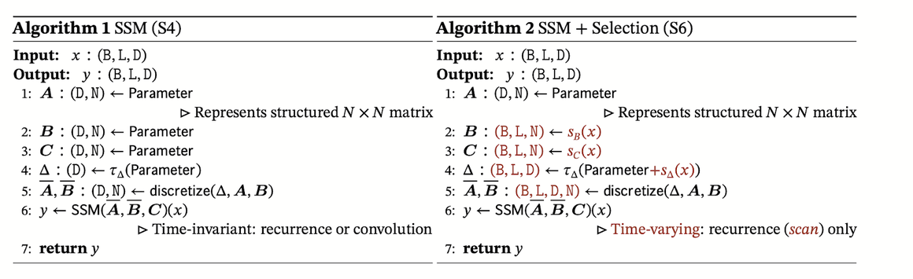

On the left, Algorithm 1 shows standard S4, where the parameters $B$, $C$, and the step size $\Delta$ are fixed learned weights with shapes $(D, N)$ or $(D)$ that stay completely frozen across every token and batch. 

Because those numbers never change from one word to the next, S4 is time invariant, meaning u can unroll the math into a static global convolution during training. 

On the right, Algorithm 2 shows Mamba (S6), where those exact three parameters gain batch and sequence length dimensions $(B, L, N)$ or $(B, L, D)$ because they are now computed dynamically from the incoming token $x$ itself via linear projections $s_B(x)$, $s_C(x)$, and $s_\Delta(x). 
When Line 5 discretizes $A$ and $B$ using that token dependent $\Delta$, the resulting transition matrices $\overline{A}$ and $\overline{B}$ become four dimensional tensors $(B, L, D, N)$ that adapt at every single timestep.

Of course, making the transition matrices vary at every step breaks the time invariant property that let S4 use fast FFT convolutions, so they engineered a hardware aware parallel scan algorithm that loads those input dependent matrices directly into fast GPU SRAM, runs the associative recurrence in parallel without writing huge intermediate states back to slow HBM, and preserves true linear scaling alongside constant memory generation.

```python
import torch
import torch.nn as nn
import torch.nn.functional as F

class SSM(nn.Module):
    def __init__(self, d_model: int, d_state: int = 16):
        super().__init__()
        self.d_model = d_model
        self.d_state = d_state
        # Static diagonal decay parameter A (kept negative for stability)
        self.log_A = nn.Parameter(torch.randn(d_model, d_state))
        # Input-dependent projections for step size delta, B, and C
        self.x_proj = nn.Linear(d_model, d_model + 2 * d_state, bias=False)
        self.D = nn.Parameter(torch.ones(d_model))

    def forward(self, x: torch.Tensor) -> torch.Tensor:
        # x: (batch, seq_len, d_model)
        B_sz, T, D = x.shape
        A = -torch.exp(self.log_A)  # (D, N)

        # Project input tokens into dynamic parameters (selection mechanism)
        delta_bc = self.x_proj(x)
        delta, B_dyn, C_dyn = torch.split(
            delta_bc, [D, self.d_state, self.d_state], dim=-1
        )
        delta = F.softplus(delta)  # (B_sz, T, D)

        # Discretize A and B dynamically at every timestep
        # A_bar: (B_sz, T, D, N), B_bar: (B_sz, T, D, N)
        A_bar = torch.exp(delta.unsqueeze(-1) * A.unsqueeze(0).unsqueeze(0))
        B_bar = delta.unsqueeze(-1) * B_dyn.unsqueeze(2)

        # Sequential scan rollout (replaced by SRAM parallel scan kernel in CUDA)
        state = torch.zeros(B_sz, D, self.d_state, device=x.device, dtype=x.dtype)
        outputs = []
        for t in range(T):
            state = A_bar[:, t] * state + B_bar[:, t] * x[:, t].unsqueeze(-1)
            y_t = (state * C_dyn[:, t].unsqueeze(1)).sum(dim=-1)
            outputs.append(y_t)

        y = torch.stack(outputs, dim=1)
        return y + x * self.D

```
Over time, MAMBA evolved to include Mamba 2 and Mamba 3 with slightly varying differences that fixed S6's biggest hardware bottleneck.

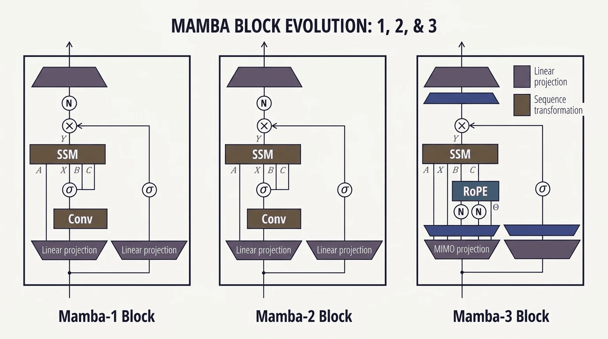

I will be using the image above as reference

On the left, the **Mamba-1 Block** splits the input through two **Linear projections**, routing the main path through **Conv** and an activation (`σ`) to generate `A`, `X`, `B`, and `C` before feeding them into the **SSM**. While this gave the model content awareness, updating separate decay rates for every channel forced the GPU to rely on slow, custom parallel scans.

In the middle, the **Mamba-2 Block** simplifies this flow via Structured State Space Duality (`SSD`), locking `A` to a single scalar per head so it can process chunks using fast matrix multiplications on GPU Tensor Cores before passing through normalization (`N`), multiplying (`×`) with the gated skip path (`σ`), and projecting out.

On the right, the **Mamba-3 Block** swaps the standard convolution for a **MIMO projection** (shown in blue) and inserts a **RoPE** module with extra normalizations (`N`) and phase angles (`Θ`) directly onto `B` and `C`. These complex rotations track tricky state logic like parity while the Multi-Input Multi-Output projections pack far higher capacity into each head without increasing inference memory.

#### But what is structured state space duality? 

**Structured State Space Duality (SSD)** simply proves that a selective state space model and masked linear attention are the exact same math viewed from two different angles.

When Mamba-2 simplifies the state matrix $A$ down to a single scalar decay per head, the sequential state update collapses into a masked matrix multiplication $(L \circ (Q K^\top)) V$.

This paper expands more on the idea of it https://arxiv.org/pdf/2510.04944

That dual view lets the model switch between two modes at will: during training, it slices prompts into chunks and computes fast matrix multiplications on GPU Tensor Cores like a Transformer, and during inference, it flips back to stepping one token at a time with constant memory like an RNN.


## RWKV

```python
Honestly, I have no idea much about RWKV because I dont really read much on it but I will try my best to explain. 
```

At its core, RWKV (Receptance Weighted Key Value) is an architecture that bridges the gap between Transformers and RNNs. Just like Mamba and GLA, it trains in parallel like a Transformer while running inference sequentially with $O(1)$ constant memory per token—avoiding the massive KV cache bottleneck of standard attention.

Instead of a standard attention block, RWKV splits each layer into two distinct mixing steps:

**Time Mixing (The Attention Replacement):** Replaces self-attention by interpolating the current token with the previous token (called **token shift**) and computing four vectors: **R**eceptance (how much past info to let through), **W**eight (a learned channel-wise decay rate) **K**ey, and **V**alue.

Instead of multiplying every token against every other token, it maintains a running exponential moving average of past keys and values weighted by $W$, then gates the result with $\sigma(R)$.


**Channel Mixing (The FFN Replacement):** Acts like a standard feed-forward network, again blending the current and previous tokens via token shift before gating the output through Receptance.

Across its versions from **RWKV-4** (scalar vector states) to **RWKV-5/6** (expanding into multi-headed 2D matrix states with dynamic, data-dependent decays like GLA) and **RWKV-7 (Goose)** (introducing generalized delta-rule state updates to overwrite stale memories like Gated DeltaNet),it has steadily evolved from a simple linear RNN into a modern matrix-state sequence model.

Now, what I am saying is also an oversimplification because RWKV can get extremely complicated. 

I mean, just look at the illustration of RWKV-7 from the official page of [RWKV](https://www.rwkv.com/)

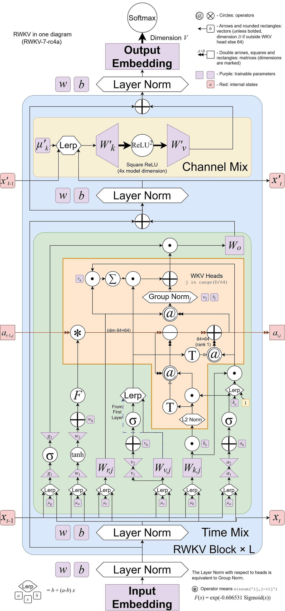

### But using the power of breaking things down into simpler blocks, the 2 channels (time mix) and (channel mix) are still there

In **Time Mix** (the green and orange box), RWKV-7 first blends the current token $x_t$ with the previous token $x_{t-1}$ (`Lerp`) so every projection immediately knows what just happened. Inside the orange `WKV Heads` block, it then updates its $64 \times 64$ memory matrix ($a_{t-1,j}$) using the Delta Rule fading old information (`*`), erasing outdated associations (`-`), and writing the new key-value pair (`+`) before querying the updated memory with Receptance ($r$) and gating the result ($g$).

In **Channel Mix** (the yellow box), the model acts like a standard feed-forward layer to process those newly retrieved features. It blends the current and previous token one last time (`Lerp`), expands the representation $4\times$ through a squared ReLU ($\text{ReLU}^2$) activation, and compresses it back down to pass on to the next block.


It is also special because it is more of a community driven project, but this idea isn't widely adopted mainly because of mature transformer infrastructure in training. 

## GLA

afaik GLA are basically the ancestors of GDN, in short it stands for gated linear attention and over the years (well specifically 2) it has evolved and been incorporated into many large production models today. 

Standard linear attention avoids the $O(N^2)$ softmax bottleneck by dropping the softmax and rearranging $(Q K^\top) V$ into $Q (K^\top V)$, compressing the entire prompt history into a single fixed-size $d \times d$ matrix state. However, without a way to clear out old tokens, that fixed memory quickly saturates with noise on long sequences.

Introduced in late 2023, [**Gated Linear Attention (GLA)**](https://arxiv.org/pdf/2312.06635) solved this by adding a data-dependent forget gate ($\alpha_t \in (0, 1)$) directly into the recurrence:

$$S_t = \alpha_t \odot S_{t-1} + k_t^\top v_t$$

This lets the model selectively decay stale information while updating the state in hardware-friendly chunks using Tensor Cores (via kernels like `FlashLinearAttention`). 

While GLA bridged the gap between linear attention and SSMs, its purely additive updates still meant new facts simply piled on top of globally decayed old ones.

Now, below is the linear recurrence formula

```python
import torch
import torch.nn.functional as F

def gla_recurrent(q: torch.Tensor, k: torch.Tensor, v: torch.Tensor, alpha: torch.Tensor) -> torch.Tensor:
    """
    Recurrent form of Gated Linear Attention (O(1) memory per step at inference).
    q, k, v, alpha: (batch, heads, seq_len, d_head)
    """
    B, H, L, D = q.shape
    gates = torch.sigmoid(alpha)
    
    # Hidden state matrix S of shape (batch, heads, d_head, d_head)
    S = torch.zeros(B, H, D, D, device=q.device, dtype=q.dtype)
    outputs = []
    
    for t in range(L):
        q_t = q[:, :, t]           # (B, H, D)
        k_t = k[:, :, t]           # (B, H, D)
        v_t = v[:, :, t]           # (B, H, D)
        a_t = gates[:, :, t]       # (B, H, D)
        
        # Decay previous state row-wise and add new key-value outer product
        S = a_t.unsqueeze(-1) * S + torch.einsum("bhi,bhj->bhij", k_t, v_t)
        
        # Query the updated state
        o_t = torch.einsum("bhi,bhij->bhj", q_t, S)
        outputs.append(o_t)
        
    return torch.stack(outputs, dim=2)
```

Surprisingly, it is possible to parallelize this in GPUs, from the original paper they mathematically prove that it is possible to unroll the recurrence into a single parallel matrix equation[cite: 11].

By defining the cumulative product of the forget gates up to step $t$ as $b_t := \prod_{j=1}^t \alpha_j$, every decay factor between step $i$ and step $t$ simplifies into a ratio $\frac{b_t}{b_i}$. 

Stacking those cumulative gates into a matrix $\mathbf{B}$ lets you absorb the decay directly into the Queries and Keys, turning the entire recurrent loop into one causal masked matrix multiplication.

$$\mathbf{O} = \left( \left( (\mathbf{Q} \odot \mathbf{B}) \left( \frac{\mathbf{K}}{\mathbf{B}} \right)^\top \right) \odot \mathbf{M} \right) \mathbf{V}$$

There is just one catch: because $b_t$ is a cumulative product of numbers between $0$ and $1$, it shrinks exponentially on long sequences, causing $\frac{\mathbf{K}}{\mathbf{B}}$ to numerically explode. 

The authors fix this by computing the attention weights in log-space ($\exp(\log \mathbf{B}_{ik} - \log \mathbf{B}_{jk})$) and using a **secondary-level chunking** trick, allowing the model to keep full numerical stability while running fast half-precision matrix multiplications on GPU Tensor Cores.


### Ok thats enough math

Now lets also write GLA in the parallel form in pytorch

```python
import torch
import torch.nn.functional as F

def gla_parallel(q: torch.Tensor, k: torch.Tensor, v: torch.Tensor, alpha: torch.Tensor) -> torch.Tensor:
    """
    Parallel form of Gated Linear Attention (log-space stabilized).
    q, k, v, alpha: (batch, heads, seq_len, d_head), where alpha in (0, 1)
    """
    L = q.shape[2]
    
    # Cumulative product in log-space: log(B_t) = sum_{j=1}^t log(alpha_j)
    log_b = torch.cumsum(F.logsigmoid(alpha), dim=2)
    
    # Causal mask M (lower triangular)
    causal_mask = torch.tril(torch.ones(L, L, device=q.device, dtype=torch.bool))
    
    # Pairwise log-decay: log(B_i) - log(B_j) for i >= j
    # Shape: (batch, heads, L, L, d_head)
    log_decay = log_b.unsqueeze(3) - log_b.unsqueeze(2)
    log_decay = log_decay.masked_fill(~causal_mask.unsqueeze(-1), float("-inf"))
    decay = torch.exp(log_decay)
    
    # Attention matrix P_{ij} = sum_d Q_{id} * K_{jd} * exp(log B_{id} - log B_{jd})
    attn = torch.einsum("bhid,bhjd,bhijd->bhij", q, k, decay)
    
    # Multiply by V
    return torch.matmul(attn, v)
```

Now all of these are pretty important because they set the scene for what we know now as GDN or gated delta networks

## GDN (1 and 2)

Even with forget gates, GLA and Mamba-2 still shared one fundamental flaw: their state updates were purely additive. Every time a new token arrived, they simply decayed the whole state matrix uniformly and piled the new key-value pair right on top, causing older associations to smear together over long contexts.

#### Note:
```
A huge portion of understanding GDN came from the original authors blog which i highly reccommend to check it out: https://sustcsonglin.github.io/blog/2024/deltanet-1/ 
```

[**Gated DeltaNet (GDN)**](https://arxiv.org/pdf/2412.06464) (introduced in December 2024 by Songlin Yang and collaborators) solved this by combining GLA's data-dependent forget gate with the classic **Delta Rule** from neural associative memory. Instead of blindly adding new facts onto the state $S_t$, GDN treats the matrix as an editable key-value store:

1. **Forget:** Decays the previous state $S_{t-1}$ globally using a data-dependent decay gate 
2. **Retrieve & Erase:** Queries the decayed state with the incoming normalized key $k_t$ to check what value it currently predicts, then this formula 
   
    $$k_t^\top (\alpha_t S_{t-1})$$
   
   computes the error against the true incoming value $v_t$, and wipes out the outdated association.
3. **Write:** Inserts the corrected association scaled by a learned write-strength gate $\beta_t \in (0, 1)$:

$$S_t = \alpha_t S_{t-1} (I - \beta_t k_t k_t^\top) + \beta_t v_t k_t^\top$$

Because the term $(I - \beta_t k_t k_t^\top)$ acts as a **Householder-like rank-1 reflection/projection**, GDN cleanly overwrites stale values for a specific key without disturbing unrelated memories.

If you realise, a good portion of this is inspired from RNNs which is true

Overtime, GDN was implemented and / or modified slightly across various large production models. Including but not limited to Qwen models and Kimi Linear models.

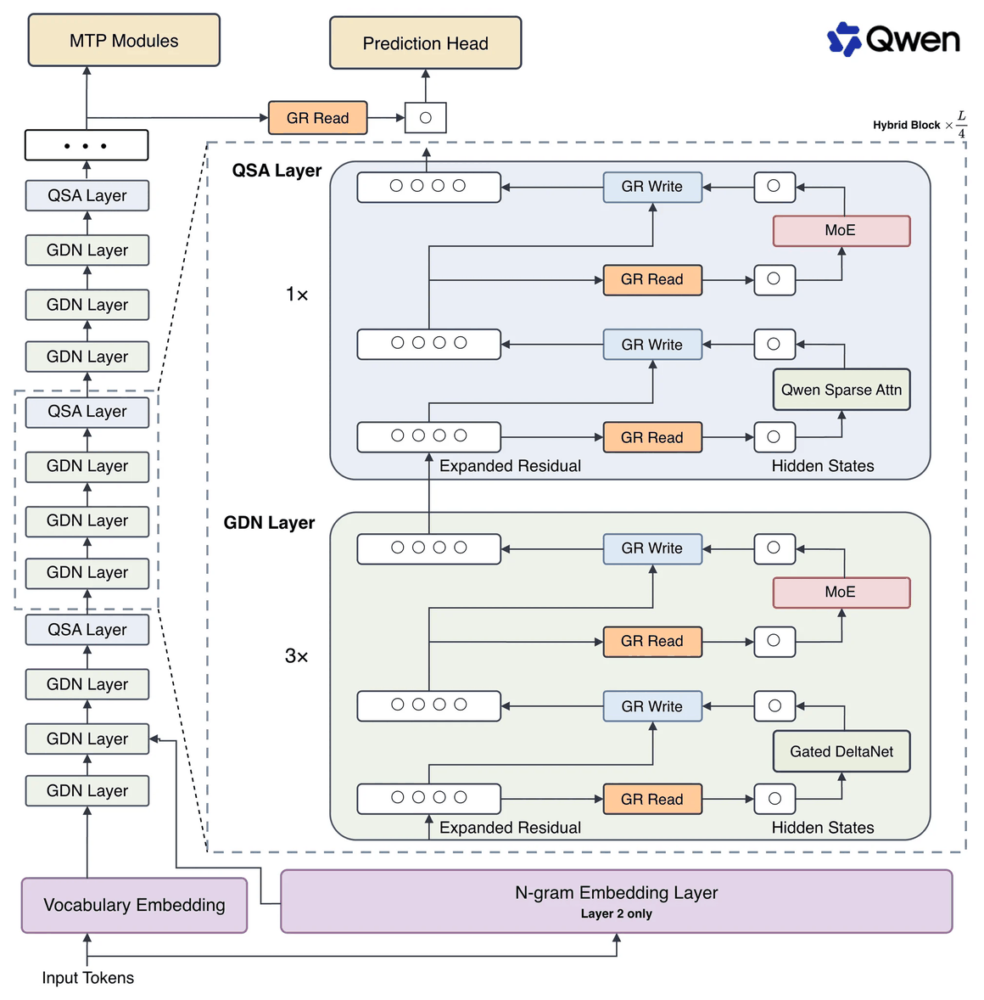
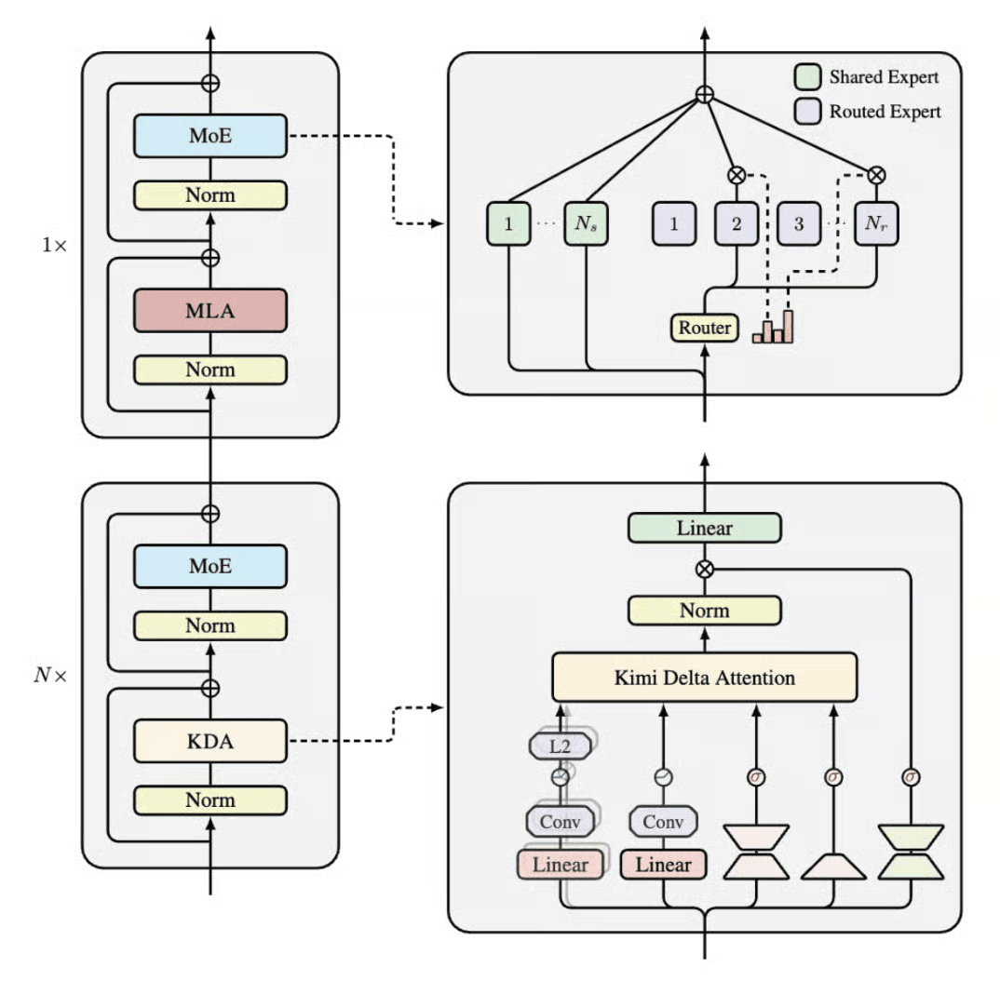


Here is the simple torch implementation of GDN: 
```python
import torch
import torch.nn.functional as F

def gdn_recurrent(
    q: torch.Tensor, 
    k: torch.Tensor, 
    v: torch.Tensor, 
    alpha: torch.Tensor, 
    beta: torch.Tensor
) -> torch.Tensor:
    """
    Recurrent form of Gated DeltaNet (GDN).
    q, k, v: (batch, heads, seq_len, d_head)
    alpha, beta: (batch, heads, seq_len, 1)
    """
    B, H, L, D = q.shape
    
    # L2-normalize q and k for stable delta-rule projections
    q = F.normalize(q, dim=-1)
    k = F.normalize(k, dim=-1)
    alpha = torch.sigmoid(alpha)  # Global decay gate in (0, 1)
    beta = torch.sigmoid(beta)    # Delta write strength in (0, 1)
    
    # State matrix S: (batch, heads, d_head, d_head)
    S = torch.zeros(B, H, D, D, device=q.device, dtype=q.dtype)
    outputs = []
    
    for t in range(L):
        q_t = q[:, :, t]                    # (B, H, D)
        k_t = k[:, :, t]                    # (B, H, D)
        v_t = v[:, :, t]                    # (B, H, D)
        a_t = alpha[:, :, t].unsqueeze(-1)  # (B, H, 1, 1)
        b_t = beta[:, :, t]                 # (B, H, 1)
        
        # 1. Decay existing memory
        S = a_t * S
        
        # 2. Retrieve current prediction for k_t and compute delta error
        v_old = torch.einsum("bhi,bhij->bhj", k_t, S)
        v_delta = b_t * (v_t - v_old)
        
        # 3. Overwrite outdated association with rank-1 delta update
        S = S + torch.einsum("bhi,bhj->bhij", k_t, v_delta)
        
        # 4. Read output
        o_t = torch.einsum("bhi,bhij->bhj", q_t, S)
        outputs.append(o_t)
        
    return torch.stack(outputs, dim=2)


```


[**Gated DeltaNet 2 (GDN-2)**](https://arxiv.org/pdf/2605.22791) (released in Nov 2026) pushed this further by fixing subtle bottlenecks faced in GDN-1 and KDA (Kimi Delta Attention):

Here is the new and improved GDN-2 

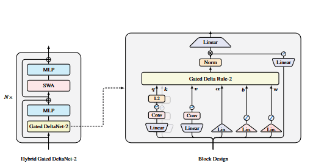

* **Decoupled, Channel-Wise Erase & Write Gates:** Earlier variants forced a single scalar $\beta_t$ to control both erasing old memory and writing new information. GDN-2 splits this into two independent, channel-wise vector gates: an **erase gate** on the key side to select which coordinates to wipe, and a **write gate** on the value side to control which channels get inserted, so the rank-1 state update cleanly asymmetric and channel-selective.

* **Negative-Eigenvalue State Transitions:** GDN-2 allows scaling *only* the erase gate $b_t$ up to $[0, 2]^{d_k}$ while keeping the write gate $w_t \in [0, 1]^{d_v}$. 
Pushing $b_t > 1$ introduces negative eigenvalues into the state transition matrix, letting the recurrence flip signs to solve tricky state-tracking tasks (like parity) without blowing up value magnitudes.

* **Asymmetric WY Parallelism & Gate-Aware Backward:** By absorbing cumulative channel-wise decays directly into normalized keys and gated erase keys, GDN-2 keeps the exact same triangular WY-representation structure  and fused Triton Tensor Core kernels as KDA. In the backward pass, it adds gate-aware gradient accumulation directly onto the WY auxiliaries so vector-valued gates train cleanly without sacrificing parallel speed.

* **Grouped-Value-Head (GQA-Style) Block Design:** Inside the token-mixer block, query-side tensors (`q`, `k`, log-decay `g`, and erase gate `b`) are repeated across value-head groups, while value-side tensors (`v` and write gate `w`) stay on the native value-head axis—cutting memory overhead while computing log-decays in `fp32` to prevent cumulative precision drift.


Now with all of these subtle improvements, the new and improved GDN is actually much faster than most improved variants we have and might actually be the most SOTA (as of Nov 2026)

Now, here is the torch implementation of GDN2
```python
import torch
import torch.nn.functional as F

def gdn2_recurrent(
    q: torch.Tensor,
    k: torch.Tensor,
    v: torch.Tensor,
    g: torch.Tensor,
    b: torch.Tensor,
    w: torch.Tensor,
    allow_negative_eigenvalues: bool = False,
) -> torch.Tensor:
    """
    Simple PyTorch recurrent reference implementation of Gated DeltaNet-2 (GDN-2).
    
    State orientation follows the paper: S_t in (B, H, d_k, d_v), o_t = S_t^T q_t
    q, k: (batch, heads, seq_len, d_k)
    v:    (batch, heads, seq_len, d_v)
    g:    (batch, heads, seq_len, d_k) - log-decay tensor (computed in fp32)
    b:    (batch, heads, seq_len, d_k) - raw logits for key-side erase gate
    w:    (batch, heads, seq_len, d_v) - raw logits for value-side write gate
    """
    B, H, L, D_k = q.shape
    D_v = v.shape[-1]

    # 1. L2 normalize q and k for stability
    q = F.normalize(q, dim=-1)
    k = F.normalize(k, dim=-1)

    # 2. Compute channel-wise decay alpha_t = exp(g_t) in fp32, plus decoupled gates
    alpha = torch.exp(g.float()).to(q.dtype)
    erase_gate = torch.sigmoid(b) * (2.0 if allow_negative_eigenvalues else 1.0)
    write_gate = torch.sigmoid(w)

    # State matrix S: (batch, heads, d_k, d_v)
    S = torch.zeros(B, H, D_k, D_v, device=q.device, dtype=q.dtype)
    outputs = []

    for t in range(L):
        q_t = q[:, :, t]           # (B, H, D_k)
        k_t = k[:, :, t]           # (B, H, D_k)
        v_t = v[:, :, t]           # (B, H, D_v)
        a_t = alpha[:, :, t]       # (B, H, D_k)
        b_t = erase_gate[:, :, t]  # (B, H, D_k)
        w_t = write_gate[:, :, t]  # (B, H, D_v)

        # Eq. (8): Decoupled erase key (e_t) and write value (z_t)
        e_t = b_t * k_t
        z_t = w_t * v_t

        # Eq. (9): Apply channel-wise decay D_t = Diag(alpha_t)
        S_bar = a_t.unsqueeze(-1) * S

        # Read existing content along the gated erase direction: r_t = S_bar^T e_t
        r_t = torch.einsum("bhkv,bhk->bhv", S_bar, e_t)

        # Asymmetric rank-1 delta update: S_t = S_bar + k_t (z_t - r_t)^T
        S = S_bar + torch.einsum("bhk,bhv->bhkv", k_t, z_t - r_t)

        # Query output: o_t = S_t^T q_t
        o_t = torch.einsum("bhkv,bhk->bhv", S, q_t)
        outputs.append(o_t)

    return torch.stack(outputs, dim=2)
```

And with that, we have come to the end of the linear network list, if you have come to the end. I would like to say congratulations and thank you for taking the time to read this. It took me quite some time because there were lots of papers I had to reference towards but I feel that it was worth it. 

Definitely learnt lots of new things along the way while writing this blog especially because there were some stuff I was unsure of (especially RWKV and its confusing af diagram).

Anyways here are the references I have put in case you are still interested in actually reading those papers

## References

Papers and technical reports

1. **Finding Structure in Time** (Jeffrey L. Elman, 1990) ([papers.baulab.info](https://papers.baulab.info/papers/Elman-1990.pdf))
2. **Long Short-Term Memory** (Sepp Hochreiter and Jürgen Schmidhuber, 1997) ([CMU reading](https://deeplearning.cs.cmu.edu/S23/document/readings/LSTM.pdf))
3. **Efficiently Modeling Long Sequences with Structured State Spaces** (Albert Gu, Karan Goel, Christopher Ré, 2021) ([arXiv:2111.00396](https://arxiv.org/abs/2111.00396))
4. **HiPPO: Recurrent Memory with Optimal Polynomial Projections** (Albert Gu et al., 2020) ([arXiv:2008.07669](https://arxiv.org/abs/2008.07669))
5. **Mamba: Linear-Time Sequence Modeling with Selective State Spaces** (Albert Gu and Tri Dao, 2023) ([arXiv:2312.00752](https://arxiv.org/abs/2312.00752))
6. **Transformers are SSMs: Generalized Models and Efficient Algorithms Through Structured State Space Duality** (Tri Dao and Albert Gu, 2024) ([arXiv:2405.21060](https://arxiv.org/abs/2405.21060))
7. **Mamba-3: Improved Sequence Modeling using State Space Principles** (Aakash Lahoti et al., 2026) ([arXiv:2603.15569](https://arxiv.org/abs/2603.15569))
8. **On Structured State-Space Duality** (2025) ([arXiv:2510.04944](https://arxiv.org/abs/2510.04944))
9. **RWKV: Reinventing RNNs for the Transformer Era** (Bo Peng et al., 2023) ([arXiv:2305.13048](https://arxiv.org/abs/2305.13048))
10. **Eagle and Finch: RWKV with Matrix-Valued States and Dynamic Recurrence** (Bo Peng et al., 2024) ([arXiv:2404.05892](https://arxiv.org/abs/2404.05892))
11. **RWKV-7 "Goose" with Expressive Dynamic State Evolution** (Bo Peng et al., 2025) ([arXiv:2503.14456](https://arxiv.org/abs/2503.14456))
12. **Gated Linear Attention Transformers with Hardware-Efficient Training** (Songlin Yang et al., 2023) ([arXiv:2312.06635](https://arxiv.org/abs/2312.06635))
13. **Parallelizing Linear Transformers with the Delta Rule over Sequence Length** (Songlin Yang et al., 2024) ([arXiv:2406.06484](https://arxiv.org/abs/2406.06484))
14. **Gated Delta Networks: Improving Mamba2 with Delta Rule** (Songlin Yang et al., 2024) ([arXiv:2412.06464](https://arxiv.org/abs/2412.06464))
15. **Gated DeltaNet-2: Decoupling Erase and Write in Linear Attention** (Songlin Yang et al., 2026) ([arXiv:2605.22791](https://arxiv.org/abs/2605.22791))
16. **Kimi Linear: An Expressive, Efficient Attention Architecture** (Kimi Team, Moonshot AI, 2025) ([arXiv:2510.26692](https://arxiv.org/abs/2510.26692))

Blogs and write-ups

17. **DeltaNet explained** (Songlin Yang, 2024) ([sustcsonglin.github.io](https://sustcsonglin.github.io/blog/2024/deltanet-1/))
18. **A Visual Guide to Mamba and State Space Models** (Maarten Grootendorst) ([newsletter.maartengrootendorst.com](https://newsletter.maartengrootendorst.com/p/a-visual-guide-to-mamba-and-state))
19. **Qwen3-Next: Towards Ultimate Training & Inference Efficiency** (Qwen Team, Alibaba, 2025) ([qwen.ai](https://qwen.ai/blog?id=qwen3-next))
20. **RWKV official site and wiki** (RWKV project) ([rwkv.com](https://www.rwkv.com/), [wiki.rwkv.com](https://wiki.rwkv.com/basic/architecture.html))

Names and credits

The people behind the work above: Jeffrey Elman, Sepp Hochreiter and Jürgen Schmidhuber, Albert Gu, Karan Goel, Christopher Ré, Tri Dao, Songlin Yang, Bo Peng and the RWKV community, the Kimi Team at Moonshot AI, and the Qwen Team at Alibaba.

Diagrams: the SSM block diagram is credited to Maarten Grootendorst and Gemini, the S4 filter walkthrough diagram was generated with Gemini, the RWKV-7 illustration comes from the official RWKV site, and the Mamba-1/2/3 block figure along with the Qwen, Kimi Linear and GDN-2 figures are reproduced from their respective papers.
