## Speculative Decoding

I have always been reading up on interesting model architectures and one of the things that stood out to me the most is speculative decoding 


## An introduction to the problem 

To understand why speculative decoding exists, you first have to accept a slightly depressing truth about modern computing: we got very good at doing math, and considerably worse at moving the numbers around to actually do it.

If you run an LLM one token at a time (which is how autoregressive generation works btw) your GPU has to haul tens of gigabytes of model weights out of high-bandwidth memory just to produce a single word. The tensor cores finish their multiplication, and then spend the rest of the step sitting around like construction workers waiting for a single dump truck to back down a one-lane alley.

In computer architecture, this is called memory-bandwidth bound.

Speculative decoding is essentially a workaround for this exact bottleneck.

Instead of hauling all those weights just to produce one token, you use those idle tensor cores to verify several guessed tokens in a single trip.

## How it works 

There are many blogs that cover on speculative decoding so I wouldn't delve in much, though I highly suggest reading the one covered by vLLM 

https://vllm.ai/blog/2024-10-17-spec-decode

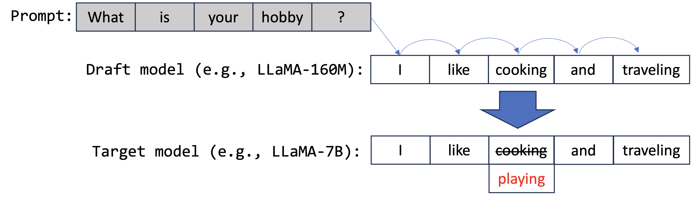

(vLLM image for reference)

In short, a smaller model predicts tokens while utilizing the same larger model to verify or adjust, it accelerates generation without sacrificing accuracy (or almost idk)

The smaller model (draft model we call it) efficiently generates multiple candidate tokens which can be verified in a single pass 

## The evolution of spec-decode

With that out of the way I want to talk about the different speculative decoding models that we have. 

```
Note: I am not including the ones that are published in papers claiming to be SOTA (since they are just varients spun out from the important ones), but rather I want to include those that are widely used in the current industry including but not limited to the optimizers (with the exception of D3D because I find that interesting)
```

## Blockwise Decoding (2018)

Before speculative decoding had a catchy name, Google proposed blockwise parallel decoding in 2018. The idea was attaching extra heads to predict multiple future tokens at once. It was clever, except it only worked for greedy decoding. The moment u wanted normal sampling, it broke the model's probability distribution. Interesting paper, mostly a dead end.

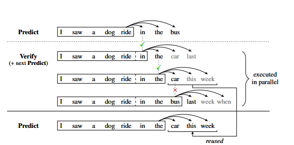

https://arxiv.org/pdf/1811.03115

## Actual SpecDecode (2022)

The actual breakthrough came in November 2022, when Google Research (Leviathan et al., [arXiv:2211.17192](https://arxiv.org/pdf/2211.17192)) and DeepMind independently arrived at the same fix: modified rejection sampling

Their core insight was that even hard language modeling contains plenty of easy stretches like closing a quote or finishing obvious syntax, where a tiny draft model can guess several tokens ahead while the giant target model grades all of them in a single parallel pass. 

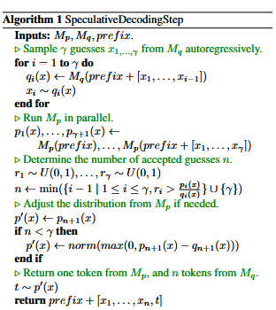

(algo as shown above)

If the draft model's probability for a token is lower than or equal to the target model's, u accept it if the draft model was overconfident, u reject it proportionally and resample from the adjusted residual distribution. This guarantees the final output distribution is 100 percent identical to running the big model alone, giving 2x to 3x speedups on T5 without retraining or touching a single weight. 


There was just one catch: in production, hosting two completely separate models meant juggling two KV caches, matching tokenizers, and burning extra VRAM. Naturally, engineers immediately set out to delete the second model.


## Medusa (2024)

Instead of hosting a separate draft model, Medusa bolted lightweight parallel heads directly onto the target model's last hidden state and verified candidate branches using tree attention. 

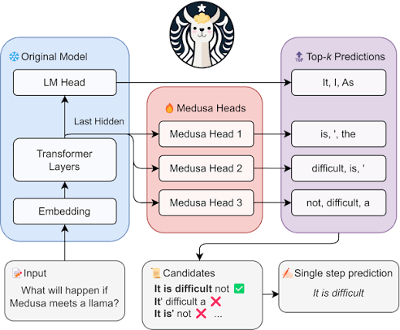

It proved you didn't need a standalone drafter, though because each head guessed blindly without seeing what the previous head picked, acceptance rates fell off a cliff after two or three tokens. But this variance itself is really dependent on the tree attention. Well there were optimizers introduced to actually fix some of the issues introduced but by then we were already moving on to other techniques. 

## EAGLE 1 2 and 3 (2024 to 2025)

Rather than guessing raw tokens from scratch, EAGLE runs a tiny autoregressive layer directly on the target model's internal hidden features. 

EAGLE 2 introduces a speculative tree with dynamic branches for better predictions

By EAGLE 3, fusing hidden features from multiple layers and training directly on token prediction pushed real world speedups past 3x to 6x.


```
Note: I actually covered a bit more in depth on Medusa && EAGLE in my telegram channel so you can read more over here: https://t.me/qkvthoughts/1202
```

As of Nov 2026, I am also well aware that there is EAGLE 3.1 (partnering vLLM, TorchSpec and EAGLE Team)

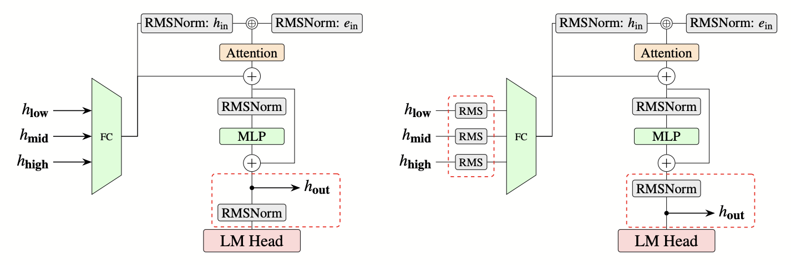

The changes introduced is just RMSNorm after the FC layer as well as at the post norm hidden states feeding into the next decoding step.

Its main benefit is better training time, more robust context and better stability 

my guess is that the RMSNorm helps to put all the layers at the same numerical magnitude since deeper layers would naturally accumulate higher activation magnitudes then earlier layers -> so it would dominate the concat at the FC layer


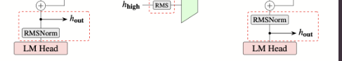

Adding RMSNorm before hout also ensures that the next autoregressive step receiving the post-norm hidden state gets bounded (if not value accumulation again)


## MTP (2024 to 2025)

Frontier labs like DeepSeek and Qwen eventually stopped waiting for post training drafters and baked sequential multi token prediction modules straight into pretraining. 

Now this idea originally came out from a paper by [Gloeckle et al. (2024)](https://arxiv.org/pdf/2404.19737) at Meta, and the idea was fairly blunt: instead of training an LLM to predict just the next token and bolting on speculative heads afterward as an emergency patch, why not force the model to predict multiple future tokens at once during pretraining?

To pull this off without blowing up GPU memory, they used a shared transformer trunk feeding into independent output heads, running the forward and backward passes on each head sequentially so they never had to materialize all those massive vocabulary logits at the same time.

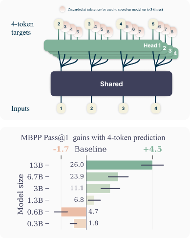

The side effects were surprisingly nice. Forcing a model to plan ahead actually made it smarter on code and algorithmic reasoning (solving around 15 percent more coding problems at the 13B scale), while giving u extra prediction heads for free self speculative decoding at inference time, hitting up to 3x speedups on code without needing a separate draft model.

Of course, nothing stays untouched for long. Meta's original version predicted future tokens in parallel from the shared trunk, which meant the heads still suffered from the classic conditional independence problem where head two couldn't see what head one actually picked.

Enter DeepSeek V3, which took inspiration from them and fixed the exact flaw that made parallel heads awkward.

DeepSeek realized that throwing away the causal chain between predicted tokens was leaving performance on the table. Instead of independent parallel heads, DeepSeek V3 makes MTP sequential and causal across D prediction depths, keeping the complete causal chain intact at every step.

Each MTP module is surprisingly lightweight because it shares both the embedding layer and the final output head with the main model. 

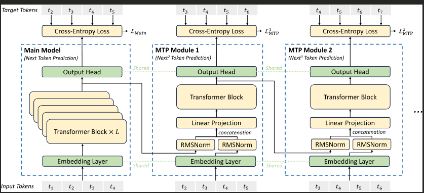

At prediction depth k, the module takes the hidden representation from the previous depth (starting with the main model's output at depth 1) alongside the embedding of the actual next token, normalizes both with RMSNorm, concatenates them, and squashes that doubled vector back down through a linear projection matrix before feeding it into a single transformer block. 

During training, the losses (Cross Entropy Loss) across all depths are averaged and scaled by a weighting factor lambda, it densifies training signals and forces the model to pre plan its representations. 

Interestingly, DeepSeek notes that keeping this causal chain is very similar in spirit to EAGLE, except DeepSeek built it primarily to make the base model smarter during pretraining rather than as an inference afterthought. Then once training finishes, you can either throw the MTP modules away completely for zero overhead serving, or keep them around as a ready made speculative draft head without ever training a separate model.
(psss basically DSpark)

## DFlash, DSpark, and DFlash 2 (2026)

At the end, even a single layer drafter is still autoregressive. If you want a 12 token draft, that little layer still has to run 12 sequential forward passes while the big model stands around waiting.

**DFlash** broke that habit in February 2026 by replacing sequential drafting with a lightweight block diffusion drafter. Instead of stepping token by token, it denoises an entire block of masked tokens in parallel in a single forward pass while injecting target KV features into the draft layers. Drafting latency suddenly stopped scaling linearly with block size.

Predicting a whole block at once introduced a new quirk though: because tokens are denoised simultaneously, adjacent tokens occasionally disagree with each other. 

**DSpark** patched this by adding a low rank Markov head to restore neighbor coherence alongside a confidence head that stops drafting early when certainty drops.

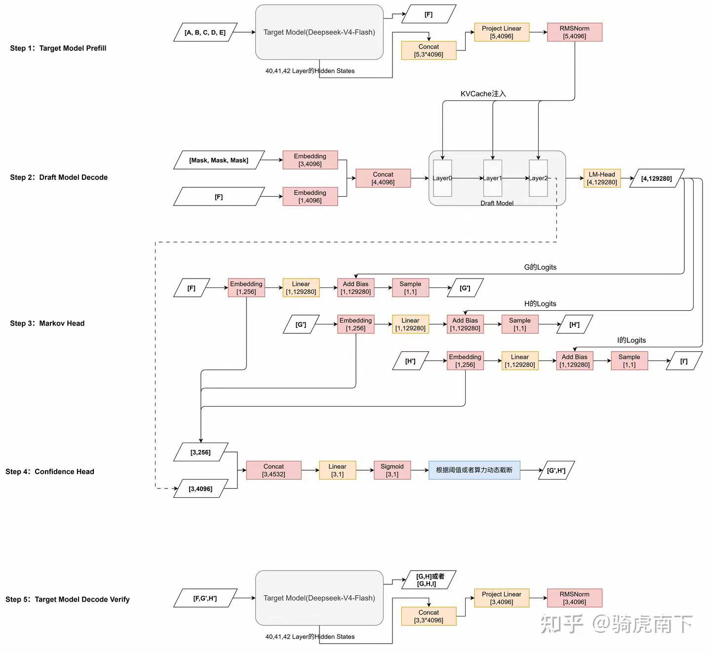

A more in depth explanation can be found on my tele channel (because im too lazy to write the iteration here) (https://t.me/qkvthoughts/1041)

**DFlash 2** tackled the same problem without giving up one pass parallel drafting, and it uses tiny two tap dynamic depthwise convolutions wrapped before and after every attention and MLP sublayer inside the drafter.

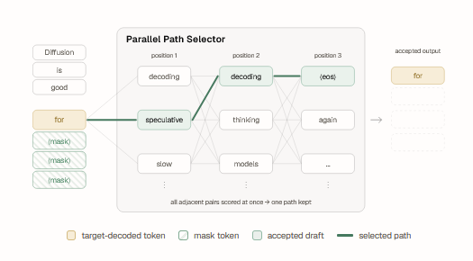

Instead of paying for ten extra layers, DFlash 2 inserts a local two tap dynamic convolution around every sublayer. At each position t, a small projection of the current hidden state generates two input dependent weights on the fly: one weight for the token slot itself, and one weight for the immediate predecessor at position t minus 1 (with the very first draft slot peeking directly at the last verified anchor token).

Pair that with a lightweight pairwise path selector that keeps each slot's top candidates and traces the single most coherent chain before verification, and you get over 20 percent more accepted output per verification pass for roughly 1 percent extra cycle latency. More of it is actually explained in inco's blog (https://inco.ai/blog/dflash2/)


## D3D (Nov 2026)

What makes D3D so compelling is not any single algorithmic miracle, because none of its three pieces are particularly on their own, so its 3 async pipelines working in tandem (in a sense)

### 1. Standalone Target-Aligned Training

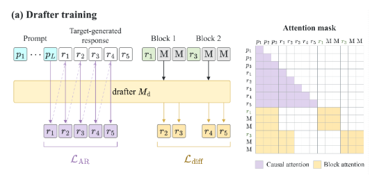

To eliminate the drafter's runtime dependency on the target model's hidden states, D3D trains a standalone diffusion drafter directly on target-generated responses.

During training, a response is split into blocks where the model sees clean prefix tokens alongside a block of `[MASK]` tokens and learns to denoise all masked positions simultaneously in one forward pass. 

Because a standalone drafter must maintain its own KV cache across long sequences without the target model periodically resetting its features, pure block diffusion can drift over time 

D3D prevents this by adding an auxiliary next-token prediction (NTP) loss on the clean prefix tokens so internal representations stay grounded, while training on target-sampled outputs aligns its phrasing and formatting with the target model.

### 2. Acceptance-Driven Layer Pruning & Self-Distillation
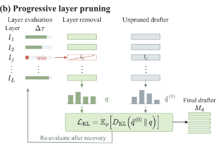

Rather than dropping transformer layers based on standard perplexity or cosine similarity which often degrades speculative acceptance disproportionately, D3D evaluates the actual validation acceptance length when removing each layer and greedily drops the layers with the smallest impact (trimming a 36-layer drafter down to 31 layers while preserving over 99% of its accepted length).

Immediately afterward, it runs lightweight self-distillation using the unpruned drafter as a teacher to recover any lost token-prediction sharpness without adding latency back.

### 3. Asynchronous Packed Speculative Inference
With the target model on `GPU 0` and the standalone D3D drafter on `GPU 1`, both accelerators run concurrently instead of taking turns. 

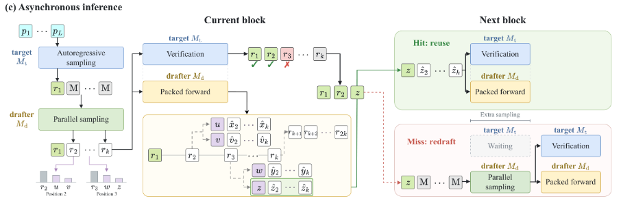

While `GPU 0` is busy verifying a block of $B$ candidate tokens, `GPU 1` does not yet know how many tokens will be accepted ($1, 2, \dots,$ or $B+1$), so it packs multiple candidate continuation prefix corresponding to those possible acceptance lengths into a single batched forward pass using a custom block-causal attention mask. 

The moment `GPU 0` finishes verification and reveals the exact accepted prefix, `GPU 1` already has the matching next draft block ready for immediate handover while simultaneously kicking off pre-drafting for the subsequent round.

## References

- **Blockwise Parallel Decoding** — Stern, Shazeer, Uszkoreit, Kaiser (Google, 2018), [arXiv:1811.03115](https://arxiv.org/abs/1811.03115)
- **Fast Inference from Transformers via Speculative Decoding** — Leviathan, Kalman, Matias (Google Research, 2022), [arXiv:2211.17192](https://arxiv.org/abs/2211.17192)
- **Medusa: Simple LLM Inference Acceleration Framework with Multiple Decoding Heads** — Cai et al. (2024), [arXiv:2401.10774](https://arxiv.org/abs/2401.10774) · [code](https://github.com/FasterDecoding/Medusa)
- **EAGLE: Speculative Sampling Requires Rethinking Feature Uncertainty** — Li, Wei, Zhang, Zhang (2024), [arXiv:2401.15077](https://arxiv.org/abs/2401.15077)
- **EAGLE-2: Faster Inference of Language Models with Dynamic Draft Trees** — Li et al. (2024), [arXiv:2406.16858](https://arxiv.org/abs/2406.16858)
- **EAGLE-3: Scaling up Inference Acceleration via Training-Time Test** — Li et al. (2025), [arXiv:2503.01840](https://arxiv.org/abs/2503.01840) · [code](https://github.com/SafeAILab/EAGLE)
- **EAGLE 3.1** — EAGLE / vLLM / TorchSpec teams (2026), [lightseek.org blog](https://lightseek.org/blog/eagle-3-1.html)
- **Better & Faster Large Language Models via Multi-token Prediction** — Gloeckle et al. (Meta, 2024), [arXiv:2404.19737](https://arxiv.org/abs/2404.19737)
- **DeepSeek-V3 Technical Report** — DeepSeek-AI (2024), [arXiv:2412.19437](https://arxiv.org/abs/2412.19437)
- **DFlash: Block Diffusion for Flash Speculative Decoding** — Chen, Liang, Liu (2026), [arXiv:2602.06036](https://arxiv.org/abs/2602.06036) · [code](https://github.com/z-lab/dflash)
- **DSpark: Confidence-Scheduled Speculative Decoding with Semi-Autoregressive Generation** — Cheng et al. (2026), [arXiv:2607.05147](https://arxiv.org/abs/2607.05147)
- **DFlash 2: Keep Drafting Parallel** — Inco AI (2026), [inco.ai/blog/dflash2](https://inco.ai/blog/dflash2/)
- **D3D: Decoupled Diffusion Drafting for Asynchronous Speculative Decoding** — Chen et al. (2026), [arXiv:2611.06425](https://arxiv.org/abs/2611.06425) · [code](https://github.com/fudan-generative-vision/D3D)
- **vLLM spec decode explainer** (2024), [vllm.ai/blog/2024-10-17-spec-decode](https://vllm.ai/blog/2024-10-17-spec-decode)

